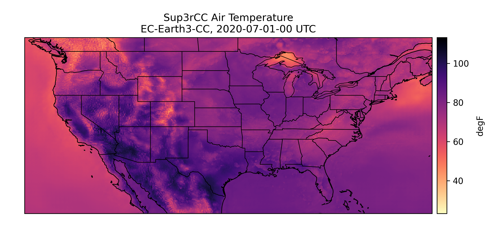
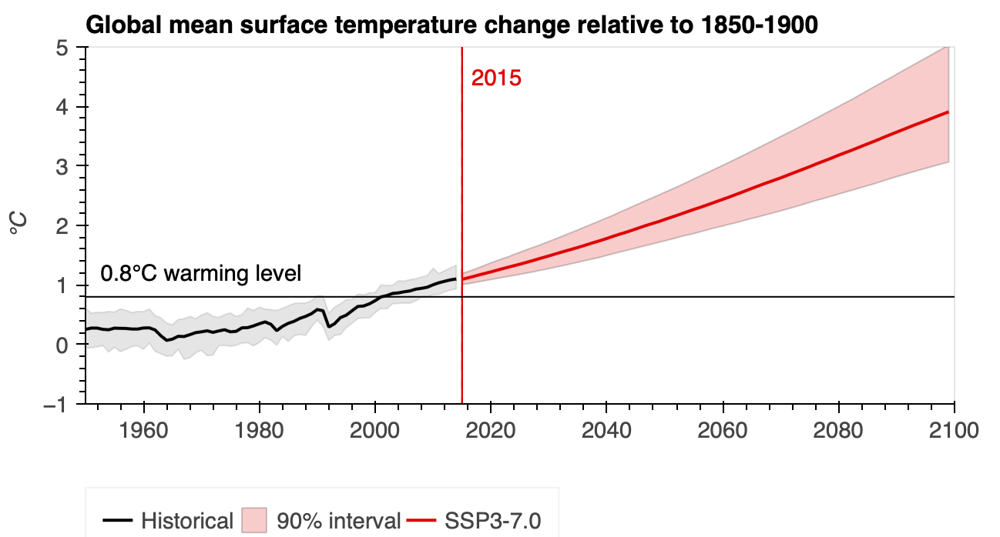

Sup3rCC at Cal-Adapt

Cal-Adapt has partnered with the National Laboratory of the Rockies (NLR) to bring the Sup3rCC dataset (reference #1) to users. 

Sup3rCC is a gridded, downscaled, high-resolution dataset created by NLR for use in renewable energy studies (reference #2). It contains wind, solar, temperature, humidity, and precipitation variables at 4 km spatial resolution and hourly or daily time resolution. Spatially, this dataset covers a large expanse of North America including all of CONUS and portions of northern Mexico and southern Canada. Five models are available using the Historical and SSP 2-4.5 scenarios for years 2000-2059. To learn more about the downscaling methods employed, see Buster et al. (2025) (reference #2)

{.d-md-none fig-alt="A map of surface air temperature from Sup3rCC over the continental United States for a single model and timestep."}
:::
::: {.content-visible when-format="pdf"}
{fig-alt="A map of surface air temperature from Sup3rCC over the continental United States for a single model and timestep."}
:::
:::

This table provides a quick look at the available data:
| | Options |
|---|---|
| Models | EC-Earth3-CC, EC-Earth3-Veg, GFDL-CM4, MPI-ESM1-2-HR, TaiESM1 |
| Scenarios | Historical, SSP 2-4.5 |
| Years | 2000-2059 (or 2000-2099 for TaiESM1) |
| Variables | Hourly: air pressure at surface, relative humidity, surface diffuse downwelling shortwave flux, surface direct downwelling shortwave flux, downwelling shortwave flux, air temperature at 2m, wind direction at 10m, wind direction at 100m, wind direction at 200m, wind speed at 10m, wind speed at 100m wind speed at 200m 
Daily: precipitation |

This dataset is provided for users who want to study renewable energy resources (solar, wind, and hydro) at high spatial resolution for near- to mid-term planning. However, this data contains many common weather variables such as air temperature, precipitation, and wind speed that can be relevant to applications beyond renewable energy planning. 

There are a few things to keep in mind when deciding whether to use Sup3rCC: 
This dataset is not appropriate for climate vulnerability assessments that require the SSP 3-7.0 scenario.  
The global warming levels processor is not implemented for Sup3rCC in climakitae due to the relatively short (60-year) time period available for most simulations. 
The simulation subset was selected based on CONUS performance (reference #3), not regional California or WECC performance.

A Jupyter notebook demonstrating how to load Sup3rCC data with climakitae can be found in our archives. This data can also be ready directly from Amazon S3 storage using the AWS command line interface or Python.

References
1. National Laboratory of the Rockies: Sup3r: Super-Resolution for Renewable Energy Resource Data (Accessed October 2026)
2. Buster, G., Benton, B., Rastogi, D., Kao, S., Castelao, G., and Eisenman., J., 2025: Second-generation downscaled earth system model data using generative machine learning. doi.org/10.1016/j.dib.2025.111774
3. L. Vimmerstedt, B. Benton, G. Buster, S. Podgorny, 2025: Selection of Global Climate Model Data for Downscaling With Generative Machine Learning and Use in the Power Planning for Alignment of Climate and Energy Systems Project. doi:10.2172/2498329
