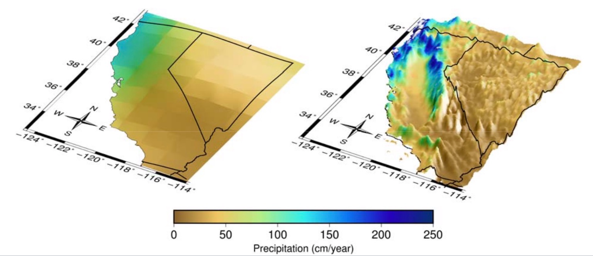

This page provides an overview of climate projections and models, and of how Analytics Engine data and tools can be used to inform planning and adaptation. It offers technical and semi-technical data users guiding materials on the most appropriate ways to use climate data in decision making, including the Do’s and Don'ts of working with climate data in the Analytics Engine. By effectively integrating climate data into sectors such as energy, municipal planning, natural resource management, and public health, data users can better anticipate and mitigate the impacts of climate change. The scientific methodology underlying each topic is documented in the [Reference Library](general-resources\reference-library.qmd).

# How climate data can inform decision making
Characterizing changing climate conditions is vital for planning and adaptation. Many sectors and communities need climate data to anticipate and plan for near- and long-term changes. By assessing the range of possible future conditions under a changing climate, communities can proactively plan for actions that can reduce the impacts of climate change and safeguard lives, livelihoods, and landscapes for decades to come.

The historical and future climate data available on the Analytics Engine can be used to analyze a variety of questions related to climate risks for an agency, community, or region. For such analyses, climate data is often used in combination with other qualitative and quantitative data, such as socioeconomic data, information on institutional capacities, local knowledge, etc. For instance, investor-owned electricity and natural gas utilities in California are required to undertake Climate Adaptation and Vulnerability Assessments. These assessments rely on climate as well as other types of data to identify the populations, infrastructure, and natural systems that are at risk of climate impacts, and to evaluate the utilities' ability to adapt to such risks.

For an introductory primer on using climate information in risk and impact assessments, users can refer to this [Guidance published by the White House](https://bidenwhitehouse.archives.gov/wp-content/uploads/2023/03/Guide-on-Selecting-Climate-Information-to-Use-in-Climate-Risk-and-Impact-Assessments.pdf). Users can also peruse this comprehensive [Climate Data Users Guide](https://apps.epri.com/climate-data-user-guide/en/) developed by the [Electric Power Research Institute](https://www.epri.com/) (EPRI) which provides a fundamental understanding of the various aspects of using climate data. EPRI's guide includes details about key concepts such as climate models, downscaling, choosing projections, and sources of historical and future climate data. Other valuable sources are also listed in the Analytics Engine website's [Reference Library](general-resources\reference-library.qmd). Definitions of key terms are available on the [Glossary](/glossary/index.qmd) page.

# How to use this guidance
Using projections of future climate to inform decision making is an inherently complex process. The science on climate change is continuously being improved and updated, and new datasets and tools for analyzing climate data are actively being developed. Policy and regulation are also evolving to better integrate future climate information, but are faced with difficult questions about how to do this in effective and rigorous ways. Developing a suitable approach for using climate projections depends on several factors, including: the climate-related question that a user wants to answer, the decision that is being made with the climate data, the type of data that is available for the region and decision-context, regulations or mandates for data use, users' technical capacities to work with climate data, users' limitations for handling large datasets, users' risk tolerance, planning timeframes, compatibility of the climate data with other data or frameworks that the user is working with, etc.

Due to this highly contextual nature of climate data use, there can be no one-size-fits-all guidance for how climate models and data should be used to answer specific planning or management-related questions. To this end, the Analytics Engine has undertaken a co-produced and deliberative process that is rooted in practice, regulation, and science, to develop a more flexible set of guiding materials. The other pages in the Scientific Guidance section offer context-specific answers for how to use the data available in the Analytics Engine. However, the onus will ultimately always be on the user to identify the best approach for data use within their specific context. It is critical that climate data users incorporate guidance that is based in scientific best practices, to ensure the integrity and appropriate interpretation of their analyses. As climate data and related policies are updated, guidance on data use will also necessarily evolve. Therefore users' approaches to climate data should be flexible and adaptable to improvements over time. For further specific questions, please reach out to [support@cal-adapt.org](mailto:support@cal-adapt.org).

For detailed guidelines on appropriate use of climate projections in the Analytics Engine, please see the [Using Climate Projections in the Analytics Engine](#using-climate-projections-in-the-analytics-engine) section below.

# About climate projections

## What are climate projections?
The data provided on the Analytics Engine are *projections*, or estimates, of potential future climates. Projections are not weather predictions and should not be treated as such. Weather is the short-term behavior of the atmosphere, and is characterized over time periods of days and weeks. Climate is the long-term behavior of the atmosphere, and it is characterized over multiple decades – it is the long-term statistics of weather conditions. The Analytics Engine provides users with the tools to characterize the long-term climate in new and novel ways, including how extremes may change in a warming climate. Climate projections cannot tell what will happen on a given date in the future, but they can describe the future climate more generally, e.g., how much warmer the typical July is likely to be or how much less snow will accumulate in the mountains in the average winter. Climate projections can also describe how much more often (or less often) extreme events such as heat waves and heavy rainfall are likely to occur in the future. The [Extreme Value Analysis](scientific-guidance\extreme-value-analysis.qmd) page covers how changes in extremes are characterized on the Analytics Engine. While they cannot predict when these events will actually occur, climate projections can give estimates for the changes in frequency and likelihood of these events occurring in the future.

## How are climate projections generated? What is a GCM?
Climate scientists create projections of future climate using powerful tools called global climate models (often referred to using the technical name "general circulation models," or GCMs). GCMs are complex computer software that crunch through thousands of mathematical equations to produce the most accurate scientific representations of how climate works. Earth System Models (ESMs) are similar to GCMs, and incorporate additional physical, chemical, and biological processes to better represent climate. Many of the [CMIP6](/glossary/index.qmd#cmip6) models either are ESMs, or incorporate several elements of them. GCMs can be used to simulate climate over past historical periods and to run experiments in which scientists impose certain conditions on the model to see how the climate system responds. This can provide key insight to major environmental processes (e.g., the impacts of deforestation). A future climate projection is the product of GCM experiments in which scientists implement a plausible scenario of the future changes in the atmospheric concentration of greenhouse gases, anthropogenic aerosols, and, in some models, land use changes (see the [About emissions scenarios](scientific-guidance\general-climate-guidance\index.qmd#sec-about-emissions-scenarios) section below).

## What is an ensemble member? What is a model ensemble?
A single climate model can be run multiple times, using slightly different sets of initial conditions. Each of these runs, or simulations of the future, is referred to as an ensemble member. Due to the chaotic nature of the Earth’s weather systems, starting from slightly different initial conditions leads to different weather outcomes for each ensemble member. By incorporating variations in this manner, ensemble members from a single model are able to to capture the internal variability of the climate system. Users of climate data can benefit from these ensembles as they generate a range of plausible future outcomes and can help decision makers better understand planning impacts. 

To capture the full spectrum of potential future outcomes, it is crucial to examine multiple models and their available ensemble members - this is often called a model ensemble. Considering multiple models enhances the robustness of statistical analyses and enables characterization of extreme events. When performing such analyses, it is important to consider the model-to-model variability and the internal variability within each model.

For users who require a comprehensive understanding of future climate projections, utilizing a diverse set of ensemble members across multiple models is recommended. Analytics Engine notebooks are intentionally designed to enable use of multiple models and ensemble members in climate data analyses. The [Model Selection](scientific-guidance\model-selection.qmd) page provides guidance on choosing among models and ensemble members, and the [Uncertainty](scientific-guidance\uncertainty\index.qmd) pages cover internal variability and model uncertainty in more detail.

# From global models to California data {#sec-global-models-ca-data}

## What is gridded data?

Gridded data in climate science refers to the method of dividing geographical areas into grid cells. Climate models then calculate variables (like temperature or precipitation) for each cell. These models produce outputs that can be visualized as maps, similar to map-based visualizations currently available in Cal-Adapt, that show average conditions across each grid cell at a given time. However, it’s important to note that these grid cell averages may differ from actual observed conditions within each cell, especially in areas with complex topography (e.g., mountains) or in urban settings where microclimates or localized effects (e.g., urban heat islands) can strongly influence the local climate. The [Temporal & Spatial Scales](scientific-guidance\temporal-spatial-scales.qmd) page provides guidance on choosing spatial resolution.

It is important to note that in the WRF data sets available on the Analytics Engine, a 9 km grid cell is not an aggregate of the corresponding 3 km grid cells for that location; rather the 9 km data is a unique, dynamically-downscaled run of the GCM that is different from the unique, dynamically-downscaled 3 km runs. This independent approach allows a wider region to be simulated by the WRF model at 9 km, and better spatial resolution to be simulated over the state of California at 3 km.

## What is downscaling?
The grid cells in most GCMs are very large – they range between 50 and 300 square kilometers. This coarse resolution is sufficient when scientists are studying climate on the global scale, but it is not as useful for adaptation and planning purposes, where data users need to understand climate change on smaller scales. Present-day climate varies greatly from region to region in California, and future climate is expected to vary accordingly. However, that detail is lost in coarse GCM outputs, where all of California may be represented by just a few large grid cells. To be able to plan for the future, higher-resolution projections of future climate need to be produced. Climate scientists therefore use various models and statistical techniques to “downscale” global climate model outputs to finer, more useful spatial scales (@fig-downscaling).

Analytics Engine data come from several GCMs downscaled to grid cells of 3km by 3km at their finest resolution, using two methods: 

- Dynamical downscaling (WRF): The Weather Research and Forecasting model (WRF), a numerical weather prediction model, simulates weather using coarser GCM outputs as boundary conditions. See [dynamical downscaling](/glossary/index.qmd#dynamical-downscaling).
- Hybrid downscaling (LOCA2-Hybrid): Localized Constructed Analogs, a hybrid statistical-dynamical technique, uses past climatological observations to add fine-scale detail to GCM output. See [statistical downscaling](/glossary/index.qmd#statistical-downscaling). 

This California-specific, high-resolution data was supported by the California Energy Commission (EPC-20-006) and produced by the Scripps Institution of Oceanography (LOCA2-Hybrid) and the University of California, Los Angeles (WRF). Links to methods, datasets, and data justification memos can be found in the [Reference Library](general-resources\reference-library.qmd). The [WRF vs. LOCA2-Hybrid](scientific-guidance\WRF-vs-LOCA2-Hybrid.qmd) page covers how the two datasets differ. 

:::: {#fig-downscaling fig-cap="Resolution difference in precipitation between the raw GCM output at a coarse resolution (left) and the fine-scale LOCA2-Hybrid downscaled output (right), showcasing how the additional granularity now depicts California climate more accurately. Figure from [Pierce et al. 2018.](https://www.energy.ca.gov/sites/default/files/2019-11/Projections_CCCA4-CEC-2018-006_ADA.pdf)"}
{fig-alt="Side-by-side comparison of coarse-resolution raw GCM precipitation output and fine-scale LOCA2-Hybrid downscaled precipitation output over California."}
::::

## What is bias correction?
While GCMs do a good job of capturing the big-picture behavior of global climate, they still contain some systematic biases (such as being consistently too hot in desert regions, or too cold in high elevation terrain). Multiple approaches are used to adjust for these biases, but all rely on data from a historical period to calculate the magnitude of the systematic offsets compared to observed historical values. Those offsets are then applied to future projections. Some [bias correction](/glossary/index.qmd#bias-correction) approaches distinguish between aspects of the climate differently, for example applying different systematic offsets to cold periods and warm periods by adjusting each quantile separately to preserve the changes in the distribution of values that a model may project (quantile- based bias adjustment).

On the Analytics Engine, all LOCA2-Hybrid data is bias-corrected: the [statistical downscaling](/glossary/index.qmd#statistical-downscaling) process includes a bias-correction step. Some of the dynamically downscaled WRF data is “a priori” bias corrected, meaning that a monthly average bias adjustment was applied before the WRF downscaling procedure, however further bias correction may be needed for some applications. Publications and data justification memos with more detail are listed in the [Reference Library](general-resources\reference-library.qmd). The [WRF vs. LOCA2-Hybrid](scientific-guidance\WRF-vs-LOCA2-Hybrid.qmd) page covers which type of bias-corrected data to use.

# About emissions scenarios {#sec-about-emissions-scenarios}

## How are greenhouse gas emissions incorporated in climate models? What is an emissions scenario?
The main driver of human-caused climate change is the emission of carbon dioxide and other greenhouse gases into the atmosphere. These greenhouse gases trap heat in the atmosphere and cause global temperatures to increase over time. Atmospheric warming in turn leads to other changes throughout earth systems. How much the climate changes in the future depends in large part on the amount of greenhouse gas emitted now and going forward, as well as upon changes in anthropogenic aerosols and land-use. However, since the greenhouse gas emissions and these other factors depend on a variety of different social, political, and economic factors, it cannot be certain how they will change. Nonetheless, scientists can use estimates of these changes to generate scenarios that can drive future climate projections.

Previous generations of climate data used Representative Concentration Pathways (RCPs) to define plausible greenhouse gas, aerosol, and land-use change scenarios (e.g., RCP 8.5). In the newest generation of models, the international community has adopted new pathways, called [Shared Socioeconomic Pathways](/glossary/index.qmd#shared-socioeconomic-pathways) (SSPs). Compared to RCPs, SSPs provide a broader view of what ‘business as usual’ might look like given different global societal changes, demographics, and economic factors (for further discussion of how SSPs were developed and how they compare to RCPs, check out the [Carbon Brief explainer](https://www.carbonbrief.org/explainer-how-shared-socioeconomic-pathways-explore-future-climate-change/)). The Analytics Engine includes climate models for three future scenarios: SSP 2-4.5, a scenario where emissions continue around present levels through mid-century and then decline; SSP 3-7.0, where emissions rise steadily through the end of the century; and SSP 5-8.5, a rapid warming scenario where current emissions levels double by 2050 (Table 1).

| EMISSIONS TRAJECTORY | DEFINITION | DESCRIPTION | OUTCOME |
|---|---|---|---|
| SSP2-4.5 | 4.5 watts per meter squared of radiative forcing in the year 2100 | Emissions continue at present levels to mid-century and then decline | 2.7°C warmer at end of century |
| SSP3-7.0 | 7.0 watts per meter squared of radiative forcing by the year 2100 | Emissions roughly double from current levels by 2100 | 3.6°C warmer at end of century |
| SSP5-8.5 | 8.5 watts per meter squared of radiative forcing by the year 2100 | Emissions roughly double from current levels by 2050 | 4.4°C warmer at end of century |

: Three of the common greenhouse gas trajectory scenarios hosted on the Analytics Engine. {#tbl-ssp}

Scenario choice is one source of uncertainty in projections, covered on the [Scenario Uncertainty](scientific-guidance\uncertainty\scenario_uncertainty.qmd) page. The [Global Warming Levels](scientific-guidance\global-warming-levels.qmd) page describes an alternative to the scenario-based approach. 

# What's on the Analytics Engine

## What climate projections and GCMs are on the Analytics Engine?
The Analytics Engine hosts climate projections from 15 GCMs. GCMs are usually named after the research center responsible for the model’s generation and maintenance. For example, the `GFDL-CM3` model is run by the National Oceanic and Atmospheric Administration (NOAA) Geophysical Fluid Dynamics Laboratory (GFDL).

Each GCM has strengths and shortcomings in how it depicts conditions for a place or a specific aspect of the climate. As a result, climate change analysis is usually best informed by use of the full range of possible model values. Using multiple models and ensemble members will help a data user capture all probable future climate conditions and produce statistical summaries across different models. Tools on the Analytics Engine have been designed to help users investigate spread across models and understand how to characterize the range of possible futures for their metric, region, and time period of interest. The [Model Selection](scientific-guidance\model-selection.qmd) page covers how to choose among models.

## What historical data are available on the Analytics Engine?
Four types of historical climate data are available in the Analytics Engine [Data Catalog](data-tools\data-catalog.qmd):

1. **HadISD archive**: Hourly historical station observations from a select number of weather stations across California and Nevada. Cal Adapt has converted the original HadISD files from the [Met Office Hadley Centre ](https://www.metoffice.gov.uk/hadobs/hadisd/) to cloud-optimized zarrs. 
2. **ERA5 reanalysis**: Reanalysis dataset that uses a variety of historical weather and ocean observations to recreate past atmospheric conditions on an hour-to-hour basis. The ERA5 product on the Analytics Engine was downscaled to a 3 km resolution using the [WRF model](https://www.mmm.ucar.edu/models/wrf).
3. **GCM historical runs**: Historical data from GCMs run specifically over the historical period (1980-2014). These historical climate time series should be interpreted as possible realizations of a historical climate, but do not attempt to precisely capture actual historical weather patterns. The historical period of GCMs is useful for applications such as calculating the difference between a historical baseline and projected future conditions under different global emissions scenarios (see [Reference Periods](scientific-guidance\reference-periods.qmd)).
4. **Historical Weather Platform data**: Hourly quality-controlled weather station data from 27 networks across Western Electricity Coordinating Council (WECC) domain from 1980-2022 (time period varies between networks and stations). 

# Limitations of these guidelines
- These guidelines provide users with a scientifically-grounded starting point for how to use climate data to answer real world questions. However, the onus is ultimately on the user to identify whether, and to what extent, these broad guidelines are sufficient for their specific context. There may be complex or nuanced cases where these guidelines either do not apply or are insufficient.
- These guidelines are only applicable to the climate projections data that are hosted in the Analytics Engine. While some of the key takeaways could also be more broadly relevant, their applicability to other regions or planning contexts has not been examined.
- Some of the recommendations require access to computing resources, tools, and notebooks, such as those in the Analytics Engine.
- These guidelines were developed based on the perspectives of a diverse but limited set of experts and their understanding of the usability of LOCA2-Hybrid and WRF datasets. As the credibility and actionability of this data is further examined by other scientists and practitioners, some of the guidelines might need to be re-considered.
- These guidelines have not yet been empirically tested/examined in terms of where (and for which applications) they work and where they do not. As users work through these guidelines, if there are suggestions for improvements please reach out to [support@cal-adapt.org](mailto:support@cal-adapt.org).
- Finally, these guidelines are not static. They are meant to be updated continuously over time as practical, scientific, and regulatory understanding of climate change evolves and as new data emerges.
