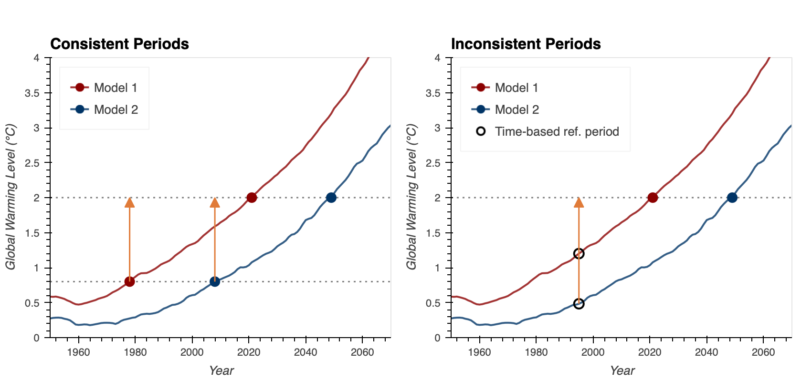
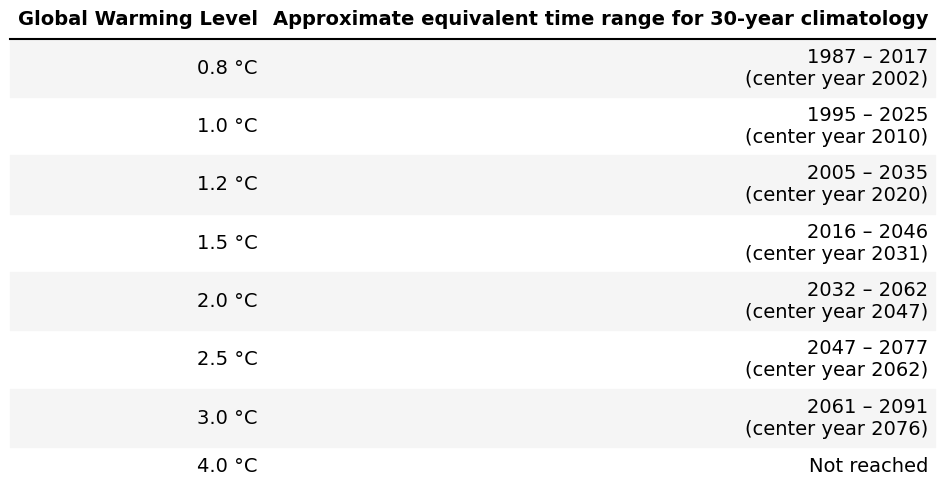
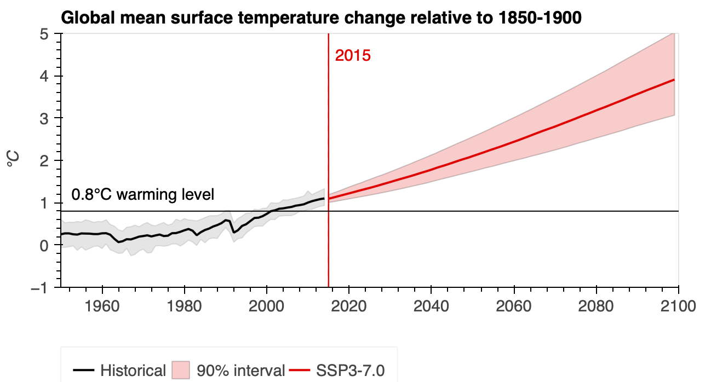

This page describes how to choose a reference period when calculating climate change signals in the Analytics Engine, for both time-based and global warming level analyses.

## What is a reference period?
To evaluate climate impacts from climate model outputs, it is often helpful to calculate the difference between future conditions and a historical reference period. This difference is called a "change signal" or a "delta signal". To compute this change signal an appropriate future timeframe and reference period must be chosen. The reference period is often called a baseline climatology. 

Both the future period and the reference period should be long enough to characterize the average climate conditions and year-to-year variability during a given historical period. It is typically recommended that the future and reference periods be 30 years long. For consistent comparisons, the future period and reference period should also generally be the same length as each other.

Depending on the goal of the analysis, reference periods can be chosen to approximate present day conditions or some other point in the past (e.g. 1950 to 1980). The choice of reference period can have a significant impact on the apparent magnitude and characteristics of the change signal, so care should be taken with this selection.

### Why use reference periods?
There are two major reasons to use a reference period to calculate a climate change signal rather than directly using future values from a climate model:

- **It frames the severity of future climate conditions in a meaningful context.** This means that relative metrics like percent change from a historical period can be calculated.
- **It helps avoid biases in climate models.** By calculating changes relative to a baseline from the same model, biases in the underlying climate state are cancelled out. The result is a better estimate of the change signal that can be directly compared between different climate models.

### Reference periods for time-based analyses
When examining future climate conditions using time-based analyses, any time period can be chosen as a reference period, provided it is sufficiently long to characterize the mean climate. Scientific best practices recommend 30 years, but 20-year reference periods may be appropriate in a limited number of application-specific cases. For the WRF simulations in the Analytics Engine [Data Catalog](/data-tools/data-catalog.qmd), the earliest year simulated is 1980, so 1980-2010 is a standard baseline climatology. For LOCA2 simulations, data extends back to 1950, so earlier climatologies can be calculated if desired.

:::{.callout-note title="Later reference periods"}
The climate simulations in the Analytics Engine data catalog use a 'historical' scenario for the years 1950-2014, and split into separate simulations that follow different SSP scenarios for years 2015 and onward. It is possible to define a reference period that extends beyond 2015 (e.g. 1995-2025), but it requires combining data from the historical scenario and a chosen SSP simulation.
:::

### Reference periods for global warming levels
When examining future climate conditions using a [global warming levels](/scientific-guidance/global-warming-levels.qmd) approach, the selected reference period should also be defined as a global warming level. This will help prevent adding uncertainty to the calculated change signal. In essence, if a time-based reference period (e.g., 1980-2010) is used as the baseline for a warming level (e.g., 2.0°C) inconsistencies can be introduced as not every simulation warms at the same rate (see Figure 1).

Using warming levels as the future target and the reference period ensures that consistent and comparable change signals are calculated for each simulation. Because global warming levels are agnostic to SSP scenarios, you do not have to choose a scenario when using a warming level as a reference period.

### How selecting GWL reference periods can influence results

- **Consistent Periods**: Comparing conditions at 2.0 °C of global warming to conditions at 0.8 °C of warming creates a consistent change signal (1.2 °C of global warming) across simulations and scenarios. This ensures that results focus on the change signal and comparative impacts.
- **Inconsistent Periods**: Comparing conditions at 2.0 °C of global warming to time-based reference of 1980-2010 results in comparing a different amount of warming in each simulation. In this example one model has warmed by 1.1 °C while the other has warmed by 1.6 °C, adding additional uncertainty to the change signal.

::: {#fig-gwl-periods fig-cap="Consistent vs. Inconsistent GWL Reference Periods. Each line shows the global mean surface temperature trajectory for an individual CMIP6 model simulation (data source: [IPCC](https://data.ceda.ac.uk/badc/ar6_wg1/data/spm/spm_08/v20210809/panel_a)) relative to 1850–1900. Left: Using GWL-based reference periods, the change signal between 0.8°C and 2.0°C is a consistent 1.2°C across all simulations (orange). Right: Using a fixed time-based reference period (1980–2010, green shading), each simulation corresponds to a different amount of warming at the reference period, introducing additional uncertainty into the change signal (orange)."}
::: {.content-visible when-format="html"}
```{=html}
<div class="figure-container d-none d-md-block">

</div>
```
{.d-md-none fig-alt="Side-by-side comparison of global mean surface temperature trajectories using GWL-based reference periods (consistent 1.2°C change signal) versus a fixed time-based reference period (variable change signal across simulations)."}
:::
::: {.content-visible when-format="pdf"}
{fig-alt="Side-by-side comparison of global mean surface temperature trajectories using GWL-based reference periods (consistent 1.2°C change signal) versus a fixed time-based reference period (variable change signal across simulations)."}
:::
:::

### Reference warming levels

The Analytics Engine has three global warming levels designed specifically to be used as reference periods, summarized in the table below.

::: {#fig-warming-levels-table fig-cap="Global Warming Levels and Approximate 30-Year Climatology Windows. Estimated center years and associated 30-year climatologies for the standard reference GWLs in the Analytics Engine. Timing of GWLs is calculated using [data from the IPCC](https://data.ceda.ac.uk/badc/ar6_wg1/data/spm/spm_08/v20210809/panel_a)."}
::: {.content-visible when-format="html"}
```{=html}
<div class="figure-container">

</div>
```
:::
::: {.content-visible when-format="pdf"}
{fig-alt="Table of estimated center years and associated 30-year climatology windows for the standard reference global warming levels used in the Analytics Engine."}
:::
:::

For each reference period, the approximate equivalent time range is determined using the IPCC's aggregation of the historical climate record and estimated timings for future warming under the SSP 3-7.0 Scenario, as shown below for the 0.8 °C warming level.

::: {#fig-warming-trajectory fig-cap="Estimate of the year the world reached 0.8 °C of warming. Figure produced by the Cal-Adapt: Analytics Engine (data source: [IPCC](https://data.ceda.ac.uk/badc/ar6_wg1/data/spm/spm_08/v20210809/panel_a))."}
::: {.content-visible when-format="html"}
```{=html}
<div class="figure-container d-none d-md-block">

</div>
```
{.d-md-none fig-alt="Global mean surface temperature trajectory showing the estimated year the world reached 0.8°C of warming."}
:::
::: {.content-visible when-format="pdf"}
{fig-alt="Global mean surface temperature trajectory showing the estimated year the world reached 0.8°C of warming."}
:::
:::

### Choosing a GWL reference period
The default reference warming level on the Analytics Engine is 0.8 °C, and is recommended unless a particular use case requires a different choice. Because 0.8 °C is the earliest warming level that can be defined with this dataset, it provides the clearest change signal to future warming levels like 1.5°C. The 1.0 °C and 1.2 °C warming levels are useful when a warming level closer to present-day conditions is needed, or if the approximate timeframe of these warming levels is more consistent with an existing planning process.

Depending on the length of the climatology that is needed, some simulations from `EC-Earth3` and `EC-Earth3-Veg` are not available at the 0.8 °C and 1.0 °C warming levels. These simulations have warmer historical temperatures, and therefore exceed 0.8 °C or 1.0 °C of warming before the start of the downscaled simulations. When 0.8°C and 1.0°C warming levels are used within the Analytics Engine, either individually or as a part of a change signal, simulations from EC-Earth3 and EC-Earth3-Veg are not retrieved. If including these simulations is important, using the 1.2 °C reference period will ensure that data from all simulations is retrieved.

### Why a pre-industrial reference period is not used
In line with the IPCC definition, global warming levels are defined as warming relative to pre-industrial conditions (years 1850-1900). This time period defines the 0 °C warming level, but this time period is not an option for a reference period for regional climate impacts on the Analytics Engine.

There are two important reasons 0 °C of warming is not used as a reference period:

1. Significant changes have occurred in the climate between the pre-industrial period and present day. From a planning perspective, pre-industrial conditions are not familiar, and not very useful in the context of modern infrastructure and societal needs.
2. The downscaled climate simulations in the Analytics Engine only extend back to 1980 (WRF) or 1950 (LOCA2), so downscaled data at 0 °C of warming is not available. The lowest global warming level that can be defined with our downscaled data is 0.8 °C.
